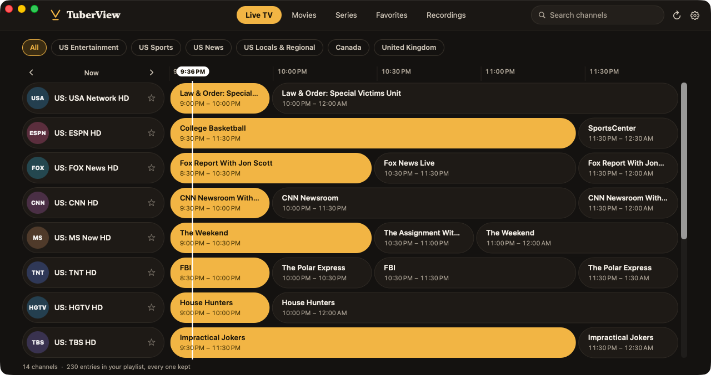
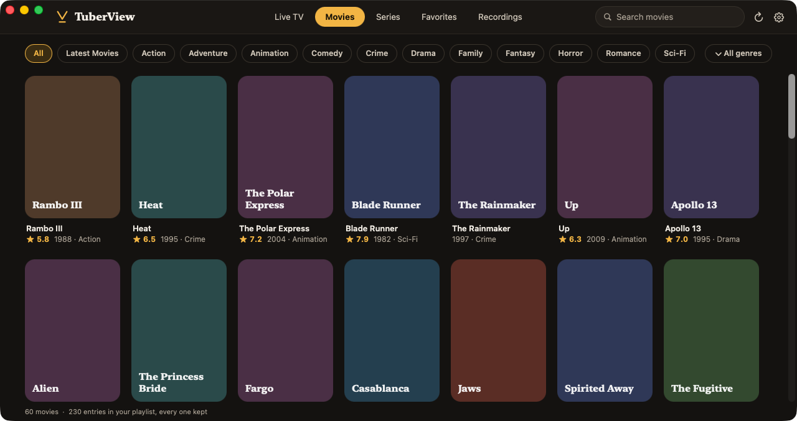
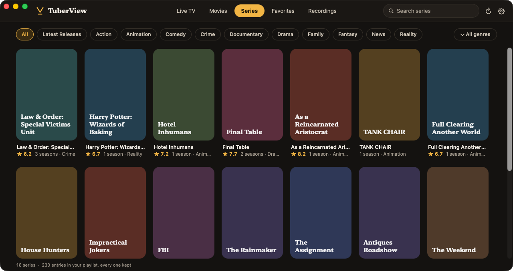

# TuberView

A free, native Mac app for watching IPTV. Give it the channel list link from
your provider, and it turns it into a tidy library of live TV, movies and
series, with a TV guide.

The link can be any web address your provider gives you. It doesn't need to end
in `.m3u`, and links like `.../get.php?username=...&type=m3u_plus` work as they
are. A playlist file saved on your Mac works too.

TuberView does not come with any channels or content. You need your own
subscription from a provider.

Made by **[DV8 Solutions LLC](https://github.com/DV8-Solutions)**. See our other apps on the [DV8 Solutions page](https://github.com/DV8-Solutions).



| Movies | Series |
|---|---|
|  |  |

<sub>Screenshots use made-up sample channels.</sub>

## Download and install

1. Go to **[Releases](../../releases/latest)** and download `TuberView.zip`.
2. Open the zip and drag **TuberView** into your **Applications** folder.
3. Open it. The app is signed and notarized by Apple, so it opens like any
   other app, with no warnings and no Terminal.

Requires macOS 12 Monterey or later. Works on Apple silicon and Intel Macs.

## First start

The first time TuberView opens, it shows Settings (also under
**TuberView → Settings…**, or **⌘,**):

- **Playlist:** paste the channel list link from your provider (any web
  address, with or without `.m3u` at the end), or choose a playlist file on
  your Mac.
- **Guide (optional):** paste the EPG (XMLTV) link from your provider to see
  what's on now and next.
- **Streams at once:** set this to the number of connections your plan
  allows. TuberView never opens more, so your account doesn't get locked.

Click **Save and Refresh** and your channels appear.

## Using it

- **Live TV, Movies, Series, Favorites and Recordings** are tabs along the top.
  Genre chips under them narrow the list.
- **Live TV** shows a guide grid. Click a channel once to play it.
- **Movies and Series** show posters with ratings. Each opens with a Top 10
  row (see below).
- **Search** (**⌘F**) finds titles in the tab you're on: channels on Live TV,
  films on Movies, shows on Series.
- **While watching**, the window shows only the picture. Move the mouse to see
  the controls, and use **Library** at the top left to go back.
- **Watch up to four at once:** **Playback → Watch Another Channel Beside
  This One** (**⌘T**). Each picture has its own controls when you hover over it.
- **Record** (**⇧⌘R**) saves what you're watching to `Movies/TuberView`, or a
  folder you choose in Settings.
- **Favorites:** **⌘D** adds or removes the current channel.
- **Refresh Channels** (**⌘R**) downloads a fresh list from your provider.
  TuberView also does this on its own when the saved list is more than six
  hours old.

If a stream freezes, drops, or was cut off because your Mac went to sleep or
changed networks, TuberView reopens it automatically.

### Keyboard shortcuts

| Action | Keys |
|---|---|
| Settings | ⌘, |
| Refresh Channels | ⌘R |
| Library | ⌘L |
| Search | ⌘F |
| Play or Pause | ⌘P |
| Stop | ⌘. |
| Next / Previous Channel | ⌘↓ / ⌘↑ |
| Mute | ⇧⌘M |
| Add to Favorites | ⌘D |
| Watch another channel beside this one | ⌘T |
| Record | ⇧⌘R |
| Full Screen | ⌃⌘F |

### Top 10 rows (optional)

With a free API key from [themoviedb.org](https://www.themoviedb.org/settings/api),
pasted into the Top 10 box in Settings, the Movies and Series Top 10 rows follow
this week's most popular titles. Without a key, they go by your provider's
ratings.

## Privacy

Your playlist link usually contains your provider username and password. TuberView
keeps it only on your Mac, in
`~/Library/Application Support/TuberView/config.json`, readable only by your
user account. TuberView has no accounts, no tracking and no servers of its own.
It only talks to your provider, the guide link you set, and TMDB if you add a key.

## Building it yourself

Builds run on GitHub's Mac machines: **Actions → Build TuberView → Run
workflow**. The built app is attached to the run.

To build on your own Mac instead:

```
scripts/fetch-vlckit.sh
brew install xcodegen
xcodegen generate
open TuberView.xcodeproj
```

| Path | What it is |
|---|---|
| `App/Sources` | The app: windows, menus, the player |
| `Packages/TuberCore` | Playlist, guide, search and recovery logic, with tests |
| `scripts/fetch-vlckit.sh` | Downloads VLCKit from VideoLAN and checks it |
| `.github/workflows/build.yml` | Builds and tests `TuberView.app` on a cloud Mac |

## Licenses

TuberView's own code: see [LICENSE](LICENSE).

Video playback is by [VLCKit](https://code.videolan.org/videolan/VLCKit),
© VideoLAN and contributors, used under the GNU Lesser General Public License
2.1. VLCKit is included unmodified as a separate framework inside the app. See
[THIRD-PARTY-NOTICES.md](THIRD-PARTY-NOTICES.md).

This product uses the TMDB API but is not endorsed or certified by TMDB.
